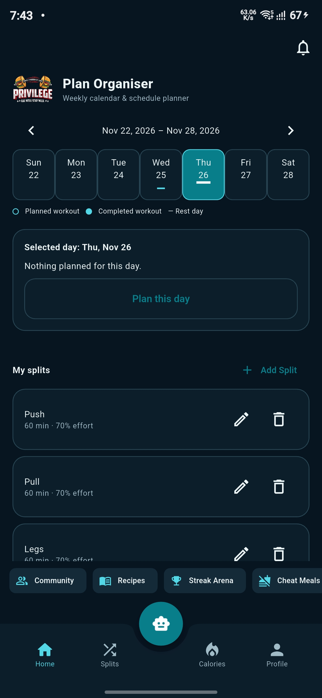
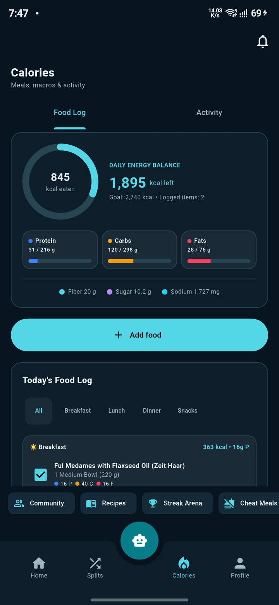
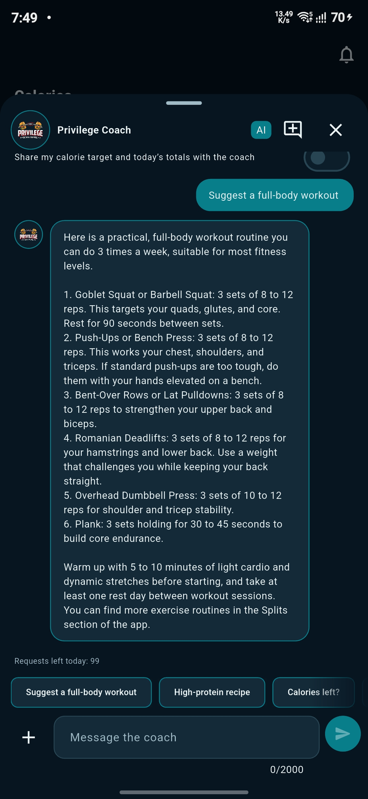
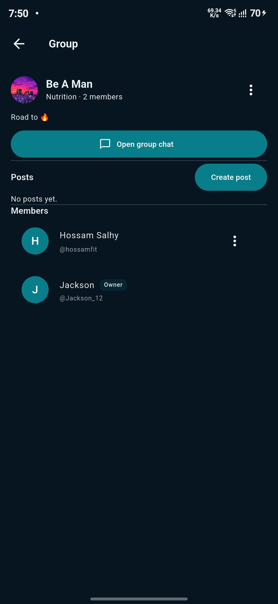
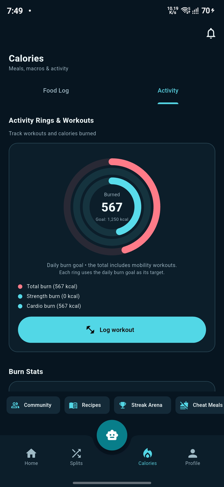
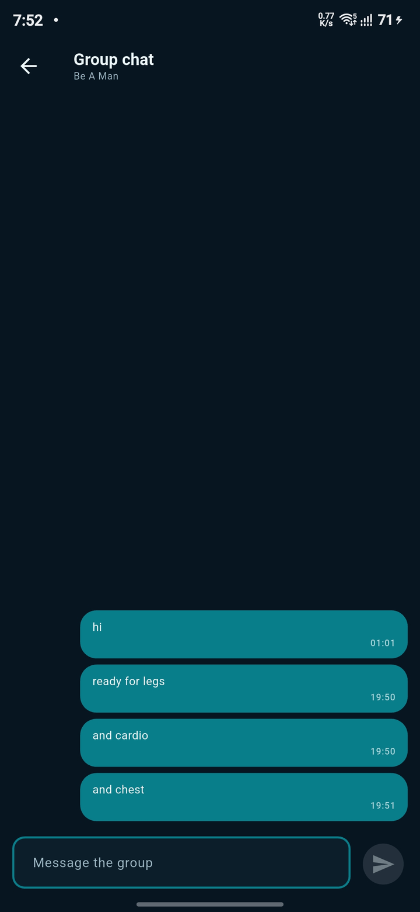
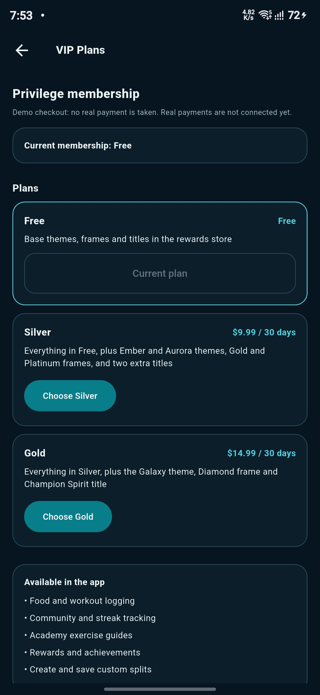
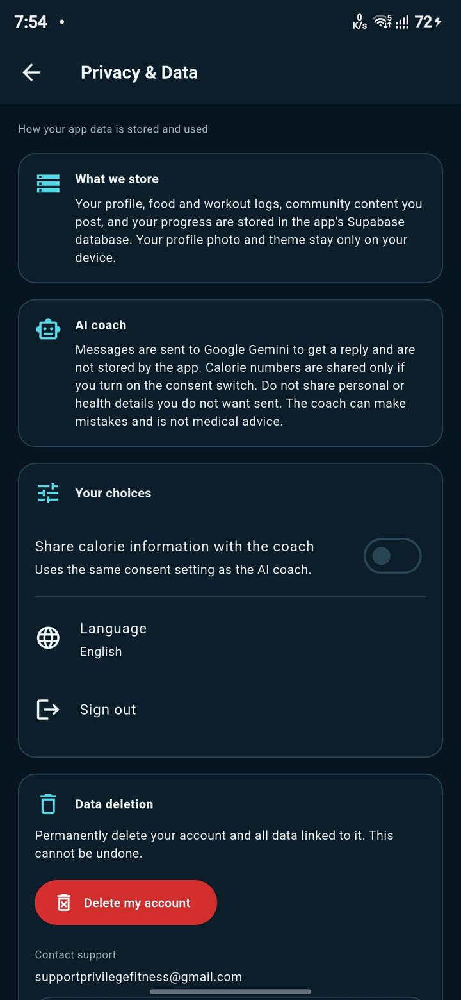
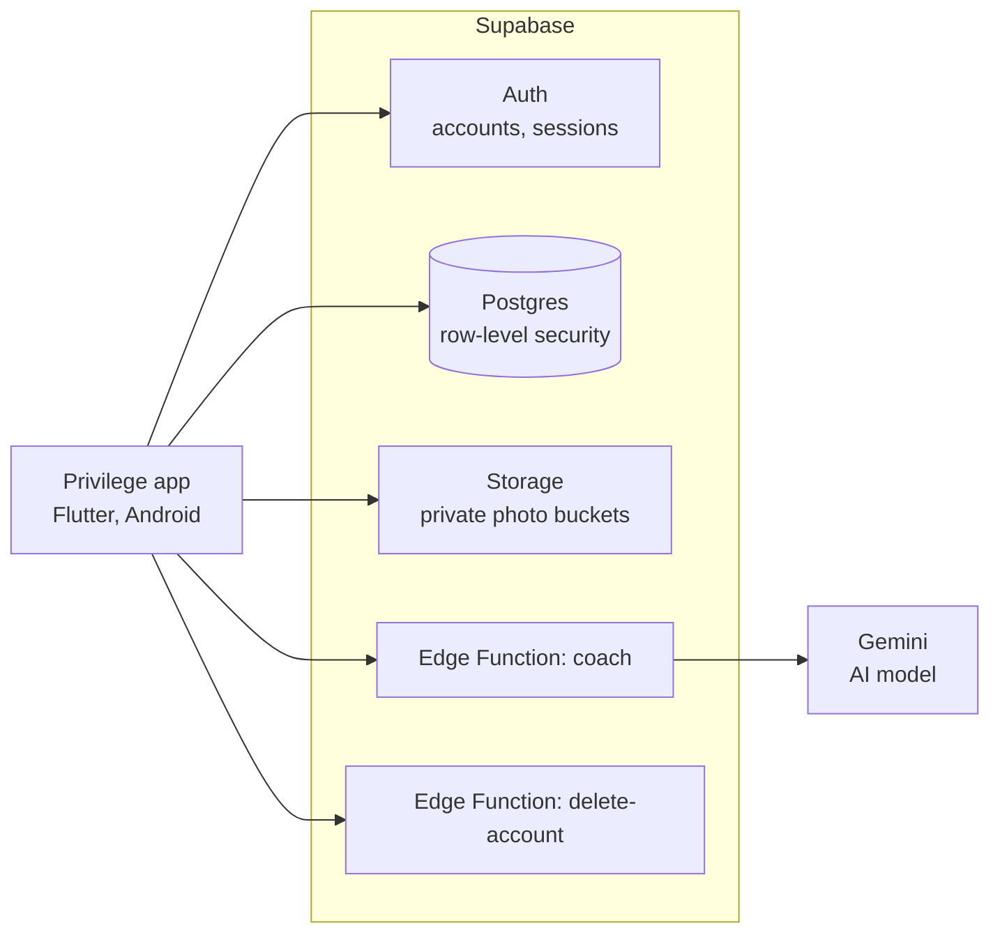

<div align="center">


# Privilege

**Eat Well; Stay Well.**

A fitness and nutrition app in one place: plan your workouts, log calories, chat with an AI coach, compete with friends and share progress. Full English and full Arabic (right-to-left).


</div>

> University course project. A working prototype: accounts, data, community and the AI coach run on real online services. See [Status](#status) for exactly what is and is not finished.

## Screenshots

| Home | Calories | AI coach | Community |
| :---: | :---: | :---: | :---: |
|  |  |  |  |

| Activity | Group chat | VIP plans (demo) | Privacy & data |
| :---: | :---: | :---: | :---: |
|  |  |  |  |

## Features

| Area | What you can do |
| --- | --- |
| **Plan organiser** | Weekly calendar, workout splits, plan each day, mark rest or done days |
| **Calories** | Food log with portions, daily calorie and macro rings, activity and burned calories, animated result after every log |
| **Recipes** | Recipes with calories and macros, logged to the food log in one tap |
| **AI coach** | Training and nutrition chat, calorie estimates from a meal photo, emergency wording answered with local numbers |
| **Streak Arena** | Streaks, public and friend challenges, weekly leaderboards |
| **Progression** | Daily XP, levels, badges, store points, a digital rewards store and Free, Silver and Gold membership plans (demo checkout) |
| **Community** | Posts with photos, likes, comments, friends, groups with an optional group chat, notifications, blocking and reporting |
| **Privacy & data** | Coach data-sharing switch, language, sign out, permanent account deletion |
| **Arabic and English** | Complete translation, right-to-left layout, Western digits |

## How it works



- The app never holds a secret key. The AI key lives only in the `coach` function.
- Every table is closed by default with row-level security. XP, points, streaks and scores are written only by the server.
- Details: [`docs/SECURITY_REVIEW.md`](docs/SECURITY_REVIEW.md) and [`supabase/README.md`](supabase/README.md).

## Tech stack

- **App:** Flutter and Dart, Material 3, ARB localization (`lib/l10n`)
- **Backend:** Supabase Auth, Postgres with RLS, Storage, Edge Functions (TypeScript on Deno)
- **AI:** Google Gemini through the `coach` Edge Function
- **Tests:** `flutter_test` widget and unit tests, SQL tests for the database rules, Deno tests for the coach logic

## Project structure

```
lib/
  screens/      One file per screen (plan, calories, coach chat, community, ...)
  services/     Supabase repositories and the coach client
  logic/        Calorie math, validators, models without UI
  l10n/         English and Arabic strings (ARB + generated code)
  ui.dart       Shared widgets and theme
supabase/
  *.sql         Database migrations (order in docs/BACKEND_SETUP.md)
  tests/        SQL tests for the database rules
  functions/    Edge Functions: coach, delete-account
test/           Flutter tests
docs/           Security review and backend setup
```

## Run it

**You need:** Flutter 3.x and an Android phone or emulator.

```bash
git clone https://github.com/DARKTYU/privilege-app.git
cd privilege-app
flutter pub get
flutter analyze
flutter test
flutter run
```

The app is already connected to the project's Supabase backend, so it works as soon as it runs. To build an installable APK:

```bash
flutter build apk --release
# build/app/outputs/flutter-apk/app-release.apk
```

Want your own copy of the backend? See [`docs/BACKEND_SETUP.md`](docs/BACKEND_SETUP.md).

## Security and privacy

A security review was done on 25 November 2026 with no high-severity findings. It covers row-level security, storage, server-only rewards, the coach function and a live database check. Read the full report in [`docs/SECURITY_REVIEW.md`](docs/SECURITY_REVIEW.md).

The AI coach is not a medical service. Messages containing emergency wording are answered with fixed local emergency numbers and are never sent to the AI. Calorie data is shared with the coach only if the user turns the switch on.

## Status

**Working:** everything in [Features](#features).

**Known limits** (also listed in the project report):
- Membership checkout is a demo: plans can be chosen and cancelled, but no real payment is taken. Themes, frames and titles from the store are saved but not applied in the app yet.
- Private messages are not built. Group chat is basic: newest 60 messages, no photos, read receipts or push notifications.
- Calories and workouts are self-reported, so leaderboards cannot be verified.
- Photo calorie estimates are rough and can differ between runs.
- The AI coach uses a free-tier provider that is sometimes slow or busy; the app retries and falls back to a second model, but failures can still happen.
- Android only; iOS was not tested.

## AI-tool declaration

Claude and GitHub Copilot were used to plan, write and review code and documents. The author set the requirements, ran the analyzer and every test, tested each build on a real phone, and decided what to accept.

## Author

Built by **DARKTYU** as a course project. Support: supportprivilegefitness@gmail.com
